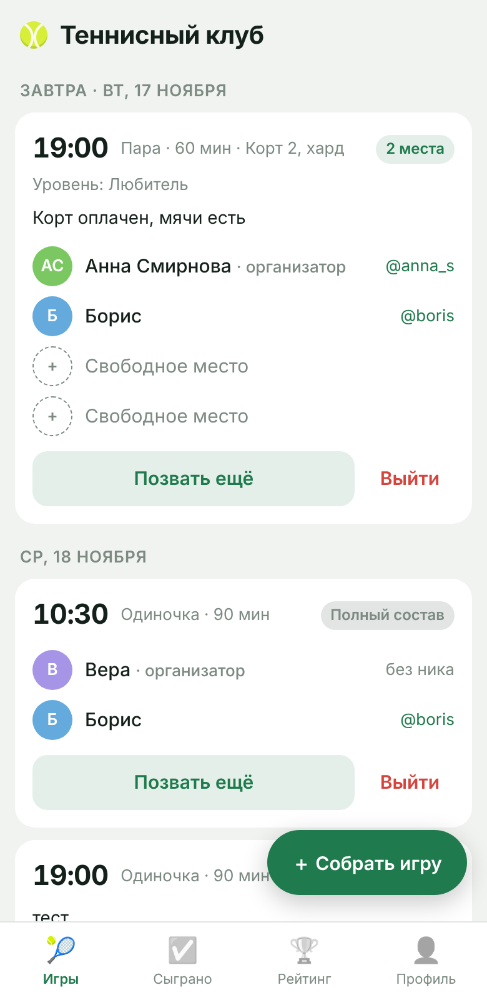

# 🎾 Теннисный клуб — Telegram Mini App

Мини-приложение для клубного комьюнити: собрать игру, найти партнёра, отметить сыгранный матч и посмотреть рейтинг активности.



## Что умеет

- **Игры** — заявка на игру (дата, время, одиночка/пара, корт, уровень, комментарий). Остальные видят её в ленте, вступают одним нажатием и пишут друг другу по нику в Telegram. Кнопка «Позвать игроков» шлёт приглашение в любой чат.
- **Сыграно** — «мы играли с тем-то»: соперники, счёт и победитель (необязательно). Прошедшие заявки сами предлагаются к отметке. Удалить ошибочную запись может любой участник матча.
- **Рейтинг** — кто сколько сыграл: по месяцам и за всё время (матчи, победы, игровые дни).
- **Уведомления** от бота: кто-то вступил / вышел / игра отменена / вас отметили в матче.
- **API для клуба** — вход по ключу: выгрузка данных и загрузка свободных кортов из таблицы клуба.

Без зависимостей: Node.js ≥ 22.13 (встроенные `node:http` и `node:sqlite`), фронтенд на чистом JS.

## Запуск

```bash
cp .env.example .env   # заполнить BOT_TOKEN и остальное
npm start              # http://localhost:3000
npm test
```

Без `BOT_TOKEN` сервер работает в **демо-режиме**: можно открыть в обычном браузере и войти под любым именем. Только для разработки — в продакшене токен обязателен, иначе вход ничем не защищён.

### Подключение к Telegram

1. Создать бота в [@BotFather](https://t.me/BotFather), токен положить в `BOT_TOKEN`.
2. Выложить сервер по HTTPS (Telegram открывает мини-аппы только по HTTPS). Есть `Dockerfile`; базу хранит в `/data` — подключите том.
3. В BotFather: `/newapp` (или Bot Settings → Menu Button) — указать URL сервера.
4. Ссылку вида `https://t.me/<бот>/<приложение>` записать в `APP_LINK` — она нужна кнопке «Поделиться».

Бот может писать только тем, кто нажал у него «Start», — попросите участников запустить бота.

Время игр хранится как местное время клуба (`CLUB_TZ`).

## API для клуба

Включается переменной `CLUB_API_KEY`. Ключ передаётся в заголовке `X-API-Key` (или `Authorization: Bearer …`).

| Метод | Путь | Что делает |
|---|---|---|
| GET | `/api/club/v1/ping` | проверка ключа |
| GET | `/api/club/v1/members` | участники |
| GET | `/api/club/v1/games` | актуальные заявки с составами |
| GET | `/api/club/v1/matches?month=2026-11` | сыгранные матчи (`month` необязателен) |
| GET | `/api/club/v1/leaderboard?month=2026-11` | рейтинг (`month=all` — за всё время) |
| GET | `/api/club/v1/slots` | загруженные свободные корты |
| PUT | `/api/club/v1/slots` | **заменить** список свободных кортов |

```bash
curl -X PUT https://example.com/api/club/v1/slots \
  -H "X-API-Key: $CLUB_API_KEY" -H "Content-Type: application/json" \
  -d '{"slots":[{"court":"Корт 1","starts_at":"2026-11-21T19:00","ends_at":"2026-11-21T20:30","price":"2500 ₽"}]}'
```

Загруженные корты появляются подсказками в форме «Собрать игру». Синхронизацию с конкретной таблицей клуба (Google Sheets, CRM и т.п.) нужно дописать отдельным скриптом, который дёргает эти методы.

## Структура

```
server/app.js    маршруты и логика      server/auth.js  проверка подписи Telegram initData
server/db.js     схема SQLite           public/         интерфейс мини-аппа
test/            тесты API
```
